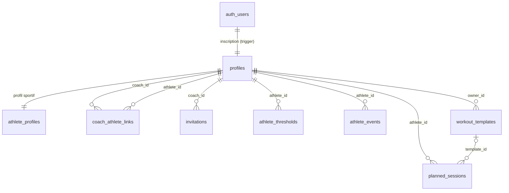

# Schéma de la base

Migrations : [`supabase/migrations`](../supabase/migrations). Tests de sécurité : [`tests/db`](../tests/db).

## Conventions

- Identifiants `uuid` (sauf `audit_logs`, en identité séquentielle).
- Instants en `timestamptz` (UTC). Une séance sans heure est une **date locale** (`date`) de l'athlète, avec une heure locale facultative (`time`) : on n'en fait jamais un instant UTC, pour éviter les décalages d'un jour.
- Valeurs énumérées en `text` + `CHECK`, plus simples à faire évoluer que des types `enum`.
- `updated_at` est maintenu par trigger ; `created_by` prend `auth.uid()` par défaut et n'est jamais modifiable.

## Tables (phase 1)

| Table | Rôle | Points clés |
| --- | --- | --- |
| `profiles` | un profil par compte | `is_coach` déclaratif ; fuseau horaire validé |
| `admin_users` | administrateurs | écrite uniquement par la clé de service ou l'éditeur SQL |
| `athlete_profiles` | objectifs, niveau, volume visé, notes | créé à l'inscription pour tout compte |
| `coach_athlete_links` | relation coach-athlète | `active` ou `revoked` ; permissions `can_edit_plan`, `can_view_activities` réglées par l'athlète |
| `invitations` | invitations à usage unique | seule l'empreinte SHA-256 du jeton est stockée ; nominative (email) ou par lien |
| `athlete_thresholds` | seuils historisés (FTP, FC seuil, allure seuil, CSS, FC max…) | une valeur par seuil et par date d'effet ; bornes plausibles contrôlées |
| `athlete_events` | compétitions | priorité A, B ou C |
| `workout_templates` | bibliothèque de séances du coach | contenu au format v1 |
| `planned_sessions` | séances planifiées | `draft`, `published`, `cancelled` ; `version` pour la concurrence optimiste |
| `audit_logs` | historique des modifications | alimenté par triggers, en lecture seule |

Tables prévues dans les phases suivantes : `comments` (phase 2), `external_connections`, `activities`, `activity_streams`, `session_activity_matches`, `sync_jobs`, `sync_logs` (phase 3), `workout_exports` (phase 4), `notifications` (phase 5).

## Sécurité

Le rôle `anon` n'a accès à aucune table. Le rôle `authenticated` reçoit des droits explicites, colonne par colonne quand c'est utile, puis chaque ligne est filtrée par une politique RLS.

| Donnée | Lecture | Écriture |
| --- | --- | --- |
| Profil | soi-même, personnes liées, administrateurs | soi-même |
| Profil sportif | l'athlète et ses coachs actifs | l'athlète |
| Seuils, compétitions | l'athlète et ses coachs actifs | l'athlète, ou un coach autorisé à planifier |
| Séances planifiées | l'athlète (hors brouillons du coach) et ses coachs actifs | l'athlète pour ses propres séances ; un coach autorisé à planifier ; l'athlète peut seulement **déplacer** les séances de son coach |
| Modèles | leur propriétaire | leur propriétaire |
| Relations, invitations | les deux parties / le coach | uniquement via les fonctions ci-dessous |
| Journal d'audit | l'athlète et ses coachs actifs | personne (triggers) |

Fonctions d'autorisation (schéma `private`, non exposé par l'API) : `is_admin`, `is_coach_of`, `coach_can_plan`, `has_athlete_access`, `can_plan_for`, `is_linked_with`.

Procédures exposées (RPC) :

| Fonction | Usage |
| --- | --- |
| `create_invitation(email?, heures)` | coach : crée une invitation, renvoie le jeton une seule fois (20 invitations en attente au maximum) |
| `get_invitation_preview(jeton)` | tout visiteur : nom du coach et état de l'invitation |
| `accept_invitation(jeton)` | athlète connecté : active la relation (adresse confirmée exigée pour une invitation nominative) |
| `revoke_invitation(id)` | coach : annule une invitation non utilisée |
| `revoke_coach_link(id)` | coach ou athlète : met fin à la relation |
| `set_coach_permissions(id, planifier, voir_activités)` | athlète : règle les droits de son coach |
| `athlete_thresholds_at(athlète, date)` | seuils en vigueur à une date, selon les droits de l'appelant |
| `current_user_is_admin()` | l'utilisateur courant est-il administrateur |

Les erreurs métier sont levées avec un code stable (`invitation_expired`, `athlete_can_only_reschedule`…), traduit par `src/lib/errors.ts`.

## Journal d'audit

Chaque création, modification et suppression sur les profils sportifs, relations, invitations, seuils, compétitions et séances est enregistrée avec son auteur. Pour une modification, seules les colonnes changées sont conservées (ancienne et nouvelle valeur). Le contenu structuré d'une séance est noté « modifié » sans être recopié, car l'enregistrement automatique le réécrit souvent.
