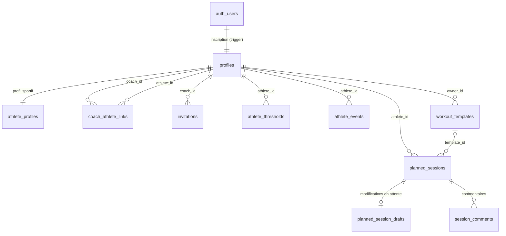
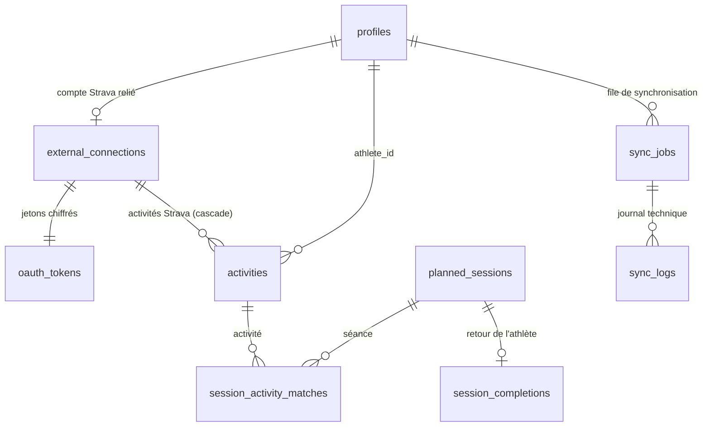

# Schéma de la base

Migrations : [`supabase/migrations`](../supabase/migrations). Tests de sécurité : [`tests/db`](../tests/db).

## Conventions

- Identifiants `uuid` (sauf `audit_logs`, en identité séquentielle).
- Instants en `timestamptz` (UTC). Une séance sans heure est une **date locale** (`date`) de l'athlète, avec une heure locale facultative (`time`) : on n'en fait jamais un instant UTC, pour éviter les décalages d'un jour.
- Valeurs énumérées en `text` + `CHECK`, plus simples à faire évoluer que des types `enum`.
- `updated_at` est maintenu par trigger ; `created_by` prend `auth.uid()` par défaut et n'est jamais modifiable.

## Tables (phases 1 et 2)

| Table | Rôle | Points clés |
| --- | --- | --- |
| `profiles` | un profil par compte | `is_coach` déclaratif ; fuseau horaire validé |
| `admin_users` | administrateurs | écrite uniquement par la clé de service ou l'éditeur SQL |
| `athlete_profiles` | objectifs, niveau, volume visé, notes | créé à l'inscription pour tout compte |
| `coach_athlete_links` | relation coach-athlète | `active` ou `revoked` ; permissions `can_edit_plan`, `can_view_activities` réglées par l'athlète |
| `invitations` | invitations à usage unique | seule l'empreinte SHA-256 du jeton est stockée ; nominative (email) ou par lien |
| `athlete_thresholds` | seuils historisés (FTP, FC seuil, allure seuil, CSS, FC max…) | une valeur par seuil et par date d'effet ; bornes plausibles contrôlées |
| `athlete_events` | compétitions | priorité A, B ou C |
| `workout_templates` | bibliothèque de séances du coach | contenu au format v1 |
| `planned_sessions` | séances planifiées | `draft`, `published`, `cancelled` ; `version` incrémentée à chaque modification ; écrite par fusion champ par champ (voir plus bas) |
| `planned_session_drafts` | modifications en attente d'une séance publiée (ou annulée) | une ligne au plus par séance ; `base` = version publiée au début de l'édition (fixée par trigger), `payload` = état voulu ; invisible pour l'athlète |
| `session_comments` | commentaires de séance | `shared` (athlète et coachs) ou `coach_private` (visible de son seul auteur) ; texte modifiable par l'auteur, visibilité figée |
| `audit_logs` | historique des modifications | alimenté par triggers, en lecture seule ; `visibility = 'coaches'` pour une séance restée brouillon |

Tables prévues dans les phases suivantes : `external_connections`, `activities`, `activity_streams`, `session_activity_matches`, `sync_jobs`, `sync_logs` (phase 3), `workout_exports` (phase 4), `notifications` (phase 5).

## Sécurité

Le rôle `anon` n'a accès à aucune table. Le rôle `authenticated` reçoit des droits explicites, colonne par colonne quand c'est utile, puis chaque ligne est filtrée par une politique RLS.

| Donnée | Lecture | Écriture |
| --- | --- | --- |
| Profil | soi-même, personnes liées, administrateurs | soi-même |
| Profil sportif | l'athlète et ses coachs actifs | l'athlète |
| Seuils, compétitions | l'athlète et ses coachs actifs | l'athlète, ou un coach autorisé à planifier |
| Séances planifiées | l'athlète (hors brouillons du coach) et ses coachs actifs | l'athlète pour ses propres séances ; un coach autorisé à planifier ; l'athlète peut seulement **déplacer** les séances de son coach |
| Modifications en attente | qui peut modifier le contenu de la séance (jamais l'athlète pour une séance du coach) | idem |
| Commentaires partagés | qui voit la séance | l'athlète et ses coachs actifs ; texte modifiable et suppression par l'auteur |
| Notes privées | leur auteur, tant qu'il coache l'athlète | un coach de l'athlète |
| Modèles | leur propriétaire | leur propriétaire |
| Relations, invitations | les deux parties / le coach | uniquement via les fonctions ci-dessous |
| Journal d'audit | l'athlète et ses coachs actifs | personne (triggers) |

Fonctions d'autorisation (schéma `private`, non exposé par l'API) : `is_admin`, `is_coach_of`, `coach_can_plan`, `has_athlete_access`, `can_plan_for`, `is_linked_with`.

Procédures exposées (RPC) :

| Fonction | Usage |
| --- | --- |
| `create_invitation(email?, heures)` | coach : crée une invitation, renvoie le jeton une seule fois (20 invitations en attente au maximum) |
| `get_invitation_preview(jeton)` | tout visiteur : nom du coach et état de l'invitation |
| `accept_invitation(jeton)` | athlète connecté : active la relation (adresse confirmée exigée pour une invitation nominative) |
| `revoke_invitation(id)` | coach : annule une invitation non utilisée |
| `revoke_coach_link(id)` | coach ou athlète : met fin à la relation |
| `set_coach_permissions(id, planifier, voir_activités)` | athlète : règle les droits de son coach |
| `athlete_thresholds_at(athlète, date)` | seuils en vigueur à une date, selon les droits de l'appelant |
| `current_user_is_admin()` | l'utilisateur courant est-il administrateur |
| `save_planned_session(séance, base, valeurs)` | enregistre une séance par fusion (voir ci-dessous) ; sert aussi aux déplacements |
| `save_session_draft(séance, base, valeurs)` | enregistre les modifications en attente d'une séance publiée, par fusion ; les supprime si elles redeviennent identiques à la version publiée |
| `publish_session_draft(séance, préférence?)` | publie les modifications en attente ; `préférence` (`mine` ou `theirs`) tranche un conflit |
| `rebase_session_draft(séance, préférence)` | recale les modifications en attente sur la version publiée actuelle, sans publier |
| `duplicate_planned_session(séance, date)` | copie une séance (une séance annulée revient en brouillon) |
| `copy_planned_week(athlète, lundi source, lundi cible, état?)` | copie une semaine jour pour jour, sans les séances annulées, en une transaction |

### Fusion champ par champ

L'éditeur envoie l'état qu'il a chargé (`base`) et l'état voulu. Seuls les champs qui diffèrent de `base` sont écrits. Si l'un d'eux a aussi été changé en base entre-temps, avec une autre valeur, rien n'est écrit : l'erreur `session_conflict` (code `PT409`, HTTP 409) liste les champs en conflit et l'interface demande quelle version garder. Les autres changements faits ailleurs (un déplacement par l'athlète, par exemple) sont conservés et repris par l'éditeur. Les verrous sont pris dans le même ordre partout (séance, puis modifications en attente).

### Temps réel

Les triggers `broadcast_planned_sessions` et `broadcast_session_comments` envoient un message `planning_changed` (Realtime Broadcast) sur le canal privé `athlete:<id>` à chaque changement visible par l'athlète. Le message ne contient que des identifiants ; les brouillons, les commentaires de brouillons et les notes privées n'en envoient pas. La politique `athlete_topic_receive` de `realtime.messages` réserve l'écoute du canal à l'athlète et à ses coachs actifs.

Les erreurs métier sont levées avec un code stable (`invitation_expired`, `athlete_can_only_reschedule`…), traduit par `src/lib/errors.ts`.

## Activités réalisées (phase 3)

Migration `20261019000000_activities.sql`.

| Table | Rôle | Points clés |
| --- | --- | --- |
| `external_connections` | compte Strava relié par l'athlète | une connexion par athlète et par fournisseur ; un compte Strava n'est relié qu'à un seul compte TriCoach ; seul l'identifiant Strava est conservé (aucun nom ni profil) ; `status` = `active` ou `reauth_required` ; `last_error` = code stable |
| `oauth_tokens` | jetons OAuth | chiffrés par l'application (AES-256-GCM, clé `TOKEN_ENCRYPTION_KEY` hors de la base, préfixe `v1.` contrôlé) ; aucun privilège ni politique : invisibles par l'API, lus par le seul serveur ; `revision` évite qu'un renouvellement en écrase un autre |
| `activities` | activités réalisées, normalisées | `source` = `strava` ou `fit_upload` ; unicité par `(athlete_id, source, external_id)` et, pour Strava, par identifiant d'activité tous comptes confondus ; instant de départ en UTC + date et heure locales de l'athlète ; mesures bornées (une valeur aberrante devient « non mesurée ») ; Strava : `expires_at` obligatoire, au plus 7 jours après la première lecture, jamais repoussé |
| `session_activity_matches` | rapprochements séance-activité | `auto` (rapprochement automatique), `confirmed` (décision de l'athlète ou du coach), `proposed` (à valider), `rejected` (écartée, jamais reproposée) ; une activité n'est rattachée qu'à une séance à la fois ; `score` et `score_details` expliquent la note |
| `session_completions` | retour de l'athlète sur une séance | `done`, `partial` ou `skipped`, RPE de 1 à 10, note (500 caractères) ; `athlete_id` recopié de la séance par trigger ; prime sur la mesure pour le statut affiché |
| `sync_jobs` | file de jobs (évènements Strava, synchronisations, maintenance) | `dedupe_key` unique : un évènement reçu deux fois ne crée qu'un job ; reprise avec attente exponentielle (2^n minutes, 6 h au plus, 6 essais) ; un report pour quota ne compte pas comme un échec ; paramètres vidés une fois le job terminé |
| `sync_logs` | journal technique | évènement et message, jamais de donnée sportive ; effacé après 30 jours |
| `provider_state` | état de l'intégration Strava | abonnement webhook (un seul par application), derniers quotas lus, suspension jusqu'à la prochaine fenêtre |

### Sécurité des activités

| Donnée | Lecture | Écriture |
| --- | --- | --- |
| Connexion Strava | l'athlète | le serveur seul (clé secrète) |
| Jetons OAuth | personne par l'API | le serveur seul |
| Activités Strava | **l'athlète seul**, et jusqu'à leur expiration (politique Strava : affichage réservé à l'athlète, cache de 7 jours au plus) | le serveur seul |
| Activités importées (FIT) | l'athlète, et ses coachs qu'il autorise à « voir ses activités importées » | l'athlète (import, suppression) |
| Rapprochements | comme l'activité et la séance concernées (un coach ne voit jamais un rapprochement avec une activité Strava) | fonctions `associate_activity` et `dissociate_activity`, et le rapprochement automatique |
| Retour de séance | l'athlète et ses coachs actifs | l'athlète |
| File, journal, état Strava | les administrateurs (sans les paramètres des jobs) | le serveur seul |

Temps réel : ce qui touche une activité Strava part sur le canal `self:<id>`, que seul l'athlète peut écouter ; les retours de séance et les fichiers FIT sur `athlete:<id>` (athlète et coachs actifs).

### Fonctions des activités

| Fonction | Usage |
| --- | --- |
| `associate_activity(séance, activité)` | rattache une activité (décision `confirmed`, jamais remise en cause par le rapprochement automatique) ; l'ancien rattachement devient `rejected` |
| `dissociate_activity(séance, activité)` | détache une activité ou écarte une proposition (`rejected`) |
| `upsert_strava_activities(connexion, activités)` | serveur : enregistre ou met à jour des activités Strava, sans jamais repousser leur expiration ni toucher à l'activité d'un autre compte |
| `claim_sync_jobs(n)` | serveur : réserve les jobs à exécuter (`skip locked`), reprend ceux bloqués depuis plus de 10 minutes |
| `run_maintenance()` | serveur : efface les activités Strava expirées, les jobs terminés depuis 7 jours, le journal de plus de 30 jours |
| `purge_my_expired_activities()` | athlète : efface ses activités Strava expirées sans attendre la tâche quotidienne |
| `athlete_sync_status(athlètes[])` | état des connexions (statut, dernière synchronisation, code d'erreur) des athlètes auxquels l'appelant a accès |
| `admin_connection_counts()` | administrateur : nombre de comptes reliés par statut (capacité de l'application Strava) |

### Rapprochement automatique

`private.rematch_window(athlète, du, au)` recalcule les rapprochements d'une fenêtre de dates, sous un verrou par athlète, à chaque arrivée, modification ou suppression d'activité et à chaque changement de séance (date, heure, discipline, durée, état). Les décisions de l'utilisateur (`confirmed`, `rejected`) ne sont jamais modifiées.

- Note (`private.match_score`) : discipline obligatoire (natation, vélo, course ; renforcement et « autre » se rapprochent entre eux), puis 45 % date (même jour 1, veille ou lendemain 0,35), 20 % heure (écart linéaire sur 4 h, 0,6 sans heure), 35 % volume (rapport de durée, sinon de distance, sur une échelle logarithmique : 1/3 ou ×3 donne 0).
- Un enchaînement est découpé en segments (vélo, course…) : chaque activité peut en occuper un.
- Rattachement automatique à partir de 0,68, seulement sans ambiguïté (aucune autre séance ou activité à moins de 0,12, sauf si celle-ci revient nettement à une autre) ; sinon, les deux meilleures séances à partir de 0,45 sont proposées à l'athlète.
- Les brouillons et les séances annulées ne reçoivent rien ; deux séances du même jour se départagent par l'heure et la durée.

Statut affiché d'une séance publiée : le retour de l'athlète s'il existe (faite, partielle, manquée) ; sinon une activité rattachée (terminée au-delà de 80 % du prévu, partielle en deçà) ; sinon « à rapprocher » si elle est passée. Une séance n'est jamais supposée manquée.

## Exports de séances (phase 4)

Migration `20261020000000_workout_exports.sql`. Règles de conversion : [EXPORTS.md](EXPORTS.md).

| Table | Rôle | Points clés |
| --- | --- | --- |
| `workout_exports` | historique des exports de séances prévues (.zwo, FIT) | une ligne par tentative, réussie (`succeeded` : nom, taille, empreinte SHA-256 du fichier) ou non (`failed` : message) ; `provider` = `zwift` (format `zwo`) ou `garmin` (format `fit`) ; `segment_index` = partie d'un enchaînement ; `session_version` = version de la séance exportée (le panneau signale un fichier périmé) ; `issues` = écarts du contrôle de compatibilité ; `athlete_id` recopié de la séance et `requested_by` fixé à l'utilisateur connecté par trigger ; disparaît avec la séance |

Sécurité : lecture par l'athlète et ses coachs actifs ; ajout par l'un d'eux, pour une séance qu'il peut lire (la politique interroge `planned_sessions` sous ses propres droits : un athlète n'exporte pas un brouillon qu'il ne voit pas) ; ni modification ni suppression par l'API.

## Notifications (phase 5)

Migration `20261021000000_notifications.sql`.

| Table | Rôle | Points clés |
| --- | --- | --- |
| `notifications` | notifications dans l'application | écrites par la base seule (triggers, tâche quotidienne), jamais par l'API ; `kind` = `session_published`, `session_updated`, `session_cancelled`, `comment`, `reconnect`, `export_failed`, `missing_feedback` ; `payload` = libellés figés (titre et date de séance, fournisseur, extrait de commentaire), jamais de donnée Strava ; l'auteur d'un changement n'est jamais prévenu ; plusieurs séances publiées en dix minutes par le même auteur donnent une notification groupée, plusieurs modifications d'une même séance une seule notification mise à jour ; effacées après 60 jours |
| `notification_preferences` | types coupés par l'utilisateur | `disabled_kinds` ; tout est actif par défaut |

Qui est prévenu : l'athlète et ses coachs actifs pour une séance publiée, modifiée, déplacée ou annulée et pour un commentaire partagé (jamais une note privée ; un brouillon ne concerne que les coachs) ; l'athlète seul pour une reconnexion Strava et pour une séance de la veille sans retour ni activité rattachée (tâche quotidienne, date locale de l'athlète, une fois par séance) ; les coachs autorisés à planifier quand un export de l'athlète échoue.

Sécurité : chacun ne lit que ses notifications et ne peut modifier que `read_at` (fonction `mark_notifications_read`) ; ses réglages sont les siens ; `notify_missing_feedback` est réservée à la clé de service.

## Comptes et rôles (phase 5)

Migration `20261021100000_admin_accounts.sql` : `admin_accounts()` liste les comptes pour un administrateur (nom, email, mode coach, administrateur, inscription, dernière connexion, nombre de relations), sans aucune donnée sportive ; `admin_set_admin(compte, oui/non)` donne ou retire le rôle d'administrateur, jamais au dernier administrateur. Les deux vérifient l'appelant (`forbidden` sinon).

## Journal d'audit

Chaque création, modification et suppression sur les profils sportifs, relations, invitations, seuils, compétitions et séances est enregistrée avec son auteur. Pour une modification, seules les colonnes changées sont conservées (ancienne et nouvelle valeur). Le contenu structuré d'une séance est noté « modifié » sans être recopié, car l'enregistrement automatique le réécrit souvent.
